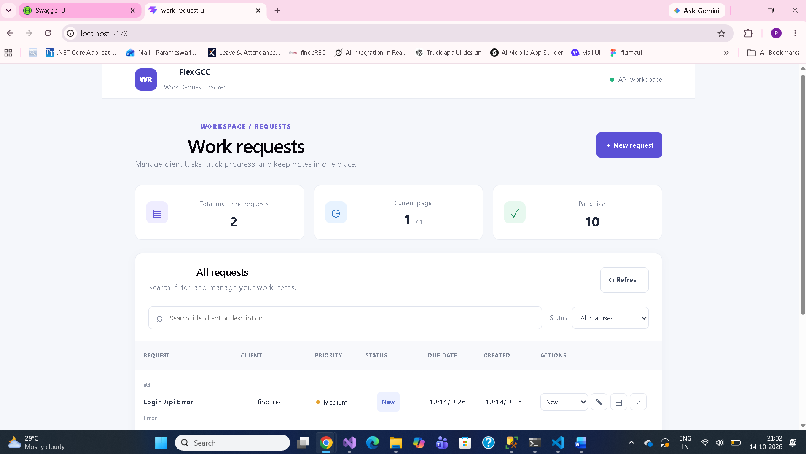
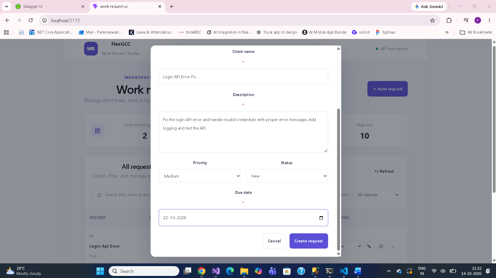
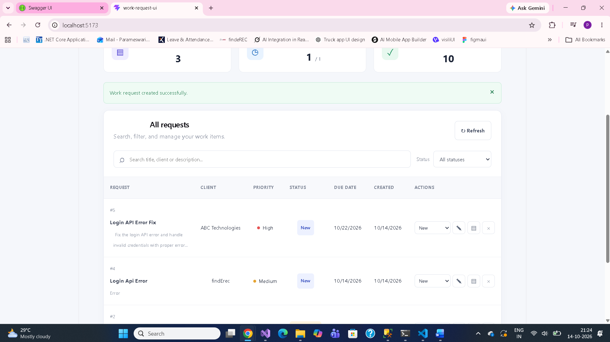
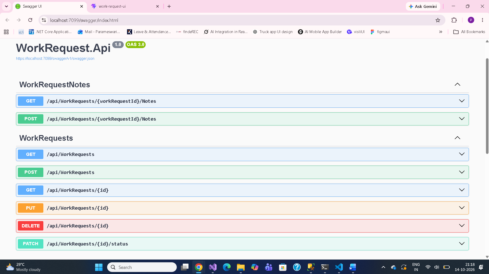
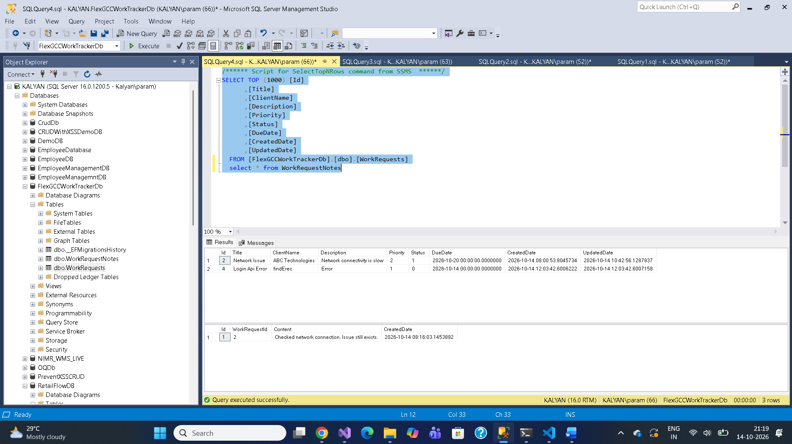

# FlexGCCWorkTracker — Work Request Tracker

A full-stack Work Request Tracker application built with ASP.NET Core Web API, React, Entity Framework Core, and Microsoft SQL Server. It helps users manage client work requests, track status and priority, filter and search records, and maintain notes for individual requests.

## Table of Contents

- [Project Overview](#project-overview)
- [Technology Stack](#technology-stack)
- [Project Structure](#project-structure)
- [Prerequisites](#prerequisites)
- [Database Configuration](#database-configuration)
- [Backend Setup and Run](#backend-setup-and-run)
- [Frontend Setup and Run](#frontend-setup-and-run)
- [API Endpoints](#api-endpoints)
- [Features](#features)
- [Database Schema](#database-schema)
- [Testing](#testing)
- [Screenshots](#screenshots)
- [Troubleshooting](#troubleshooting)
- [Known Limitations](#known-limitations)

## Project Overview

FlexGCCWorkTracker is designed to manage client work requests in one place. Each request contains details such as its title, client, description, priority, status, due date, creation date, and last updated date.

The application provides a React-based user interface and a REST API backed by SQL Server.

## Technology Stack

### Backend
- C#
- ASP.NET Core Web API (.NET 8)
- Entity Framework Core 8
- Microsoft SQL Server
- Swagger / OpenAPI

### Frontend
- React
- JavaScript / JSX
- Vite
- CSS

### Database
- Microsoft SQL Server
- Entity Framework Core Code First migrations

## Project Structure

```text
FlexGCCWorkTracker/
├── WorkRequest.Api/
│   ├── Controllers/
│   ├── Data/
│   ├── DTOs/
│   ├── Middleware/
│   ├── Models/
│   ├── Migrations/
│   ├── appsettings.json
│   └── Program.cs
├── work-request-ui/
│   ├── public/
│   ├── src/
│   │   ├── assets/
│   │   ├── App.jsx
│   │   ├── App.css
│   │   └── main.jsx
│   ├── package.json
│   └── vite.config.js
├── .gitignore
├── FlexGCCWorkTracker.sln
└── README.md
```

*Note: The structure above summarizes the main project areas. Individual files may differ as the project evolves.*

## Prerequisites

Install the following tools before running the application:

1. [.NET 8 SDK](https://dotnet.microsoft.com/download/dotnet/8.0)
2. [Node.js and npm](https://nodejs.org/)
3. [Microsoft SQL Server](https://www.microsoft.com/sql-server)
4. [SQL Server Management Studio (SSMS)](https://learn.microsoft.com/sql/ssms/download-sql-server-management-studio-ssms)
5. [Visual Studio Code](https://code.visualstudio.com/) or Visual Studio

Verify the installations:

```bash
dotnet --version
node -v
npm -v
```

## Database Configuration

### 1. Start SQL Server

Ensure your SQL Server instance is running and your Windows account has permission to connect.

The development environment uses the following database name:

`FlexGCCWorkTrackerDb`

### 2. Configure the connection string

Open:

`WorkRequest.Api/appsettings.json`

Configure the `DefaultConnection` connection string for your own SQL Server instance.

Example:

```json
{
  "ConnectionStrings": {
    "DefaultConnection": "Server=YOUR_SERVER;Database=FlexGCCWorkTrackerDb;Trusted_Connection=True;TrustServerCertificate=True;"
  }
}
```

Replace `YOUR_SERVER` with your SQL Server instance name. For example, a local SQL Server instance might use `localhost` or `YOUR_COMPUTER_NAME\\SQLEXPRESS`, depending on your installation.

The original development environment used Windows authentication. Use a suitable connection string for your own environment.

**Important:** The connection string must match the database you intend to use. Check `Properties/launchSettings.json` and your environment variables if the application connects to a different database unexpectedly. Environment variables can override values in `appsettings.json`.

### 3. Install or verify Entity Framework Core CLI

Check whether the EF Core CLI is installed:

```bash
dotnet ef --version
```

If it is not installed, run:

```bash
dotnet tool install --global dotnet-ef --version 8.0.0
```

If it is already installed, do not install it again.

### 4. Apply database migrations

Open a terminal in the backend project directory:

```bash
cd WorkRequest.Api
```

Restore the backend dependencies:

```bash
dotnet restore
```

Apply existing migrations:

```bash
dotnet ef database update
```

This applies pending migrations to the configured database. The initial migration is already part of the project.

Do not create another initial migration or delete the existing database just to run the application.

### 5. Verify the database

Open SQL Server Management Studio and connect to the configured SQL Server instance.

Verify that the `FlexGCCWorkTrackerDb` database contains:

- `dbo.WorkRequests`
- `dbo.WorkRequestNotes`
- `dbo.__EFMigrationsHistory`

The work request table stores request information, and the notes table stores notes associated with each work request.

## Backend Setup and Run

### 1. Open the backend directory

From the repository root:

```bash
cd WorkRequest.Api
```

### 2. Restore packages

```bash
dotnet restore
```

### 3. Apply database migrations

```bash
dotnet ef database update
```

Run this command after configuring the correct connection string and before starting the API, particularly on a new development machine.

### 4. Start the API

```bash
dotnet run
```

The application prints the listening URLs in the terminal. In the current development environment, the HTTPS URL is:

`https://localhost:7099`

Open Swagger:

[https://localhost:7099/swagger/index.html](https://localhost:7099/swagger/index.html)

If your application starts on a different port, use the URL printed in the terminal.

Swagger can be used to inspect the available endpoints and send API requests.

Keep this terminal open while using the frontend.

## Frontend Setup and Run

Open a **second terminal** from the repository root. Do not stop the backend terminal.

### 1. Navigate to the frontend directory

```bash
cd work-request-ui
```

### 2. Install dependencies

```bash
npm install
```

### 3. Start the React development server

```bash
npm run dev
```

Vite prints the frontend URL in the terminal. In the current development environment, the URL is:

[http://localhost:5173](http://localhost:5173)

Open that URL in your browser.

### 4. Verify frontend and backend connectivity

Ensure that:

- The backend API is running.
- The SQL Server connection is working.
- The frontend API base URL matches the backend URL.
- The frontend can retrieve work requests from the API.

The frontend currently uses the backend base URL configured in `work-request-ui/src/App.jsx`. If your backend uses a different port, update that URL accordingly.

## API Endpoints

The following endpoints are implemented in the backend controllers.

| Method | Endpoint | Purpose |
|---|---|---|
| GET | `/api/WorkRequests` | Retrieve work requests with search, filters, sorting, and pagination |
| GET | `/api/WorkRequests/{id}` | Retrieve a work request by ID |
| POST | `/api/WorkRequests` | Create a work request |
| PUT | `/api/WorkRequests/{id}` | Update a work request |
| DELETE | `/api/WorkRequests/{id}` | Delete a work request |
| GET | `/api/WorkRequests/{workRequestId}/Notes` | Retrieve notes for a work request |
| POST | `/api/WorkRequests/{workRequestId}/Notes` | Add a note to a work request |

### Work request list query parameters

The GET list endpoint supports the following query parameters:

- `search` — searches title, client name, and description
- `clientName` — filters by client name
- `status` — filters by status enum value
- `priority` — filters by priority enum value
- `fromDate` — filters by creation date from the specified date
- `toDate` — filters by creation date through the specified date
- `pageNumber` — page number, starting at 1
- `pageSize` — records per page, from 1 to 100
- `sortBy` — supported sort fields include title, clientName, priority, status, dueDate, updatedDate, and createdDate
- `descending` — enables descending sorting when `true`

Example:

```text
https://localhost:7099/api/WorkRequests?pageNumber=1&pageSize=10&sortBy=CreatedDate&descending=true
```

The list response includes pagination information such as `pageNumber`, `pageSize`, `totalCount`, `totalPages`, and `data`.

### Enum values

**Priority**

| Value | Priority |
|---:|---|
| 0 | Low |
| 1 | Medium |
| 2 | High |

**Status**

| Value | Status |
|---:|---|
| 0 | New |
| 1 | InProgress |
| 2 | Blocked |
| 3 | Completed |

## Features

### Work request management
- Create work requests.
- View all work requests.
- Retrieve a request by ID.
- Update existing work requests.
- Delete work requests.

### Search, filtering, and pagination
- Search by title, client name, or description.
- Filter by client name, priority, status, and creation date range.
- Sort using supported fields in ascending or descending order.
- Retrieve paginated results.

### Notes management
- Add notes to a work request.
- Retrieve notes associated with a work request.
- Maintain a one-to-many relationship between work requests and notes.

### Validation and error handling
- Request DTO validation using ASP.NET Core model validation and Data Annotations.
- Validation of IDs, pagination parameters, and date filters.
- Appropriate HTTP responses for successful requests, invalid input, and missing records.
- Global exception-handling middleware for unexpected server errors.

## Database Schema

### WorkRequests

Stores the main work request information:

- `Id`
- `Title`
- `ClientName`
- `Description`
- `Priority`
- `Status`
- `DueDate`
- `CreatedDate`
- `UpdatedDate`

### WorkRequestNotes

Stores notes associated with requests:

- `Id`
- `WorkRequestId`
- `Content`
- `CreatedDate`

### Relationship and indexes

One work request can have multiple notes. The foreign key `WorkRequestId` links each note to its work request. Cascade delete is configured for this relationship.

The EF Core model configures these indexes:

- Composite index on `(Status, CreatedDate)`
- Index on `ClientName`
- Index on `WorkRequestId` in the notes table

These indexes are intended to improve common filtering and note-retrieval queries. Their actual performance benefit depends on the queries and data volume.

## Testing

Use Swagger and the React frontend to test the application.

Suggested manual test cases:

1. Retrieve all work requests.
2. Create a work request with valid data.
3. Retrieve the newly created request by ID.
4. Update a work request.
5. Search by title or client name.
6. Filter by status and priority.
7. Test pagination and sorting.
8. Add a note to an existing request.
9. Retrieve notes for that request.
10. Request a non-existent ID and verify the not-found response.
11. Submit invalid pagination values and verify validation.
12. Delete a work request and verify that it is no longer returned.

Record the actual outcomes of these tests before reporting them as completed. These are recommended manual test cases, not a claim that an automated test suite exists.

## Screenshots

### 1. Work Request Dashboard


### 2. Create Work Request


### 3. Successful Work Request Creation


### 4. Swagger API Endpoints


### 5. SQL Server Database Tables


## GitHub Repository

[FlexGCCWorkTracker – GitHub Repository](https://github.com/parames89/FlexGCCWorkTracker)

## Troubleshooting

### SQL Server connection failure

- Confirm SQL Server is running.
- Check the instance name in `DefaultConnection`.
- Verify Windows authentication permissions.
- Check whether environment variables or launch profiles override the connection string.
- Confirm the database name is `FlexGCCWorkTrackerDb`.

### Migration command fails

- Ensure the terminal is in `WorkRequest.Api`.
- Run `dotnet restore`.
- Verify `dotnet ef --version`.
- Check the connection string and SQL Server availability.
- Review the migration error before changing the database.

### Frontend cannot connect to the API

- Confirm the backend is running.
- Verify the API URL configured in `App.jsx`.
- Confirm the HTTPS port matches the backend listening URL.
- Check browser developer tools for network errors or CORS errors.

### Port is already in use

Use the URL and port printed by the backend or Vite terminal. Update the frontend API URL if the backend port changes.

## Known Limitations

- The current setup is intended for local development and evaluation.
- SQL Server configuration must be adapted to the target environment.
- Automated unit and integration test coverage should be added or expanded.
- Authentication and role-based authorization are not implemented in the current version.
- Azure deployment and production configuration are not completed as part of the current implementation.
- Production use would require additional security hardening, configuration management, and monitoring.

## Repository

GitHub: [https://github.com/parames89/FlexGCCWorkTracker](https://github.com/parames89/FlexGCCWorkTracker)

## License

No license has been specified for this repository. Add a license if you intend to grant others explicit permission to use, modify, or distribute the project.
